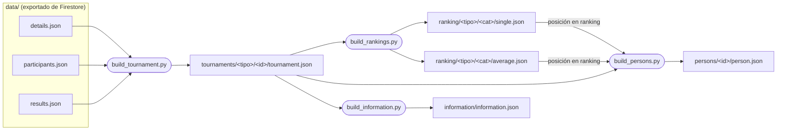

# Legion Cubo Data

Datos públicos de los torneos de Legion Cubo (estilo WCA), generados como archivos JSON estáticos para servirse gratis desde **GitHub Pages**.

## Flujo de los scripts



Cada script usa la salida del anterior, así que **siempre se ejecutan en este orden**:

| Paso | Comando | Lee | Escribe |
|---|---|---|---|
| 1 | `py build_tournament.py` | `data/*.json` (el torneo que esté en `data/`) | `tournaments/<tipo>/<id>/tournament.json` |
| 2 | `py build_rankings.py` | **todos** los `tournaments/*/*/tournament.json` | `ranking/<tipo>/<cat>/single.json` y `average.json` |
| 3 | `py build_persons.py` | **todos** los `tournaments/*/*/tournament.json` + `ranking/` | `persons/<id>/person.json` |
| 4 | `py build_information.py` | **todos** los `tournaments/*/*/tournament.json` | `information/information.json` |

> `build_persons.py` necesita que `ranking/` esté actualizado: si se ejecuta antes que `build_rankings.py`, las posiciones del ranking quedan desactualizadas.

### Agregar un torneo nuevo

1. Reemplazar los 3 archivos de `data/` con los del nuevo torneo.
2. Ejecutar los 4 scripts en orden. `build_tournament.py` muestra un menú para elegir el tipo de torneo:
   ```
   Selecciona el tipo de torneo:
     1. virtual  (por defecto)
     2. presencial
   Opción [1-2, Enter = virtual]:
   ```
   Para saltarse el menú: `py build_tournament.py --type virtual`. Los tipos disponibles se editan en `TOURNAMENT_TYPES` dentro del script.
3. Subir los cambios a GitHub.

Los torneos anteriores se mantienen en `tournaments/`, por lo que `persons/` y `ranking/` siempre se recalculan con el historial completo.

### Notas

- Los scripts se pueden ejecutar varias veces: cada uno recalcula todo desde cero y sobrescribe sus archivos. Si los datos no cambian, la salida es idéntica.
- Los archivos viejos **no se borran**. Si se elimina un torneo, una persona o una categoría, hay que borrar a mano su carpeta en `persons/` o `ranking/`.
- Los tiempos están en **segundos**. `-1` significa DNF. Si un intento tiene `penalty: "+2"`, el `time` **no** incluye los 2 segundos (mostrar `time + 2`).

---

## Estructura de los JSON

### 1. `tournaments/<tipo>/<id>/tournament.json`

Todo el torneo en un solo objeto. Se eliminan los campos privados (`createdAt`, `created_at`, `groupId`, `datetime`).

| Campo | Tipo | Descripción |
|---|---|---|
| `id` | string | Identificador del torneo (nombre de la carpeta) |
| `title`, `badge`, `description` | string | Textos del torneo |
| `about_tournament`, `participate` | string | Textos largos de la página del torneo |
| `statusType` | string | Estado (`finished`, …) |
| `dateRange` | string | Fechas en texto |
| `start_date`, `end_date` | string | `YYYY-MM-DD` |
| `photo` | string | URL del banner |
| `created_by` | string | Organizador |
| `categories` | string[] | Categorías (`333`, `222`, `333oh`, …) |
| `cronograma` | object[] | Horario por día (`day`, `shedule[]`) |
| `type` | string | Tipo elegido en el menú (`virtual`, `presencial`) |
| `participants_count` | number | Cantidad de participantes |
| `participants` | object[] | Ver tabla **participant** |
| `events` | object[] | Ver tabla **event** |

**participant**

| Campo | Tipo | Descripción |
|---|---|---|
| `id` | string | Id del competidor |
| `name` | string | Nombre visible |
| `country_iso` | string | País (ISO 3166, ej. `PE`) |
| `lexo_configuration` | object | Colores y traje del Lexo **en este torneo** |

**event** → `{ id: categoría, rounds: round[] }`

**round**

| Campo | Tipo | Descripción |
|---|---|---|
| `id` | string | Id de la ronda (ej. `final-333`) |
| `id_round` | number | Orden de la ronda en el torneo |
| `type_round` | string | `first-round`, `final`, … |
| `state_round` | string | Estado de la ronda |
| `participants_pass_round` | number | Cuántos pasan a la siguiente ronda |
| `results` | object[] | Ver tabla **result** (ordenado por puesto) |

**result**

| Campo | Tipo | Descripción |
|---|---|---|
| `pos` | number | Puesto (por promedio, desempate por single) |
| `id_participant`, `name_participant` | string | Competidor |
| `country_iso` | string | País |
| `state_participant` | string | Estado del competidor |
| `best`, `average`, `worst` | number | Tiempos en segundos (`-1` = DNF) |
| `attempts` | object[] | `{ id_time, time, penalty, scr }` |

---

### 2. `persons/<id>/person.json`

Historial de un competidor en todos los torneos.

| Campo | Tipo | Descripción |
|---|---|---|
| `id`, `name` | string | Competidor |
| `country_iso` | string | País |
| `competitions_count` | number | Cantidad de torneos en los que compitió |
| `podiums` | object | Medallas, ver tabla **podiums** |
| `personal_records` | object | `{ <cat>: { single, average } }`, ver tabla **record** |
| `history_lexo` | object[] | Lexos distintos que ha usado, ver tabla **lexo** (vacío `[]` si no tiene) |
| `events` | object | `{ <cat>: participation[] }`, del torneo más reciente al más antiguo |

**podiums**

| Campo | Tipo | Descripción |
|---|---|---|
| `gold` | number | Veces en 1er lugar |
| `silver` | number | Veces en 2do lugar |
| `bronze` | number | Veces en 3er lugar |
| `total` | number | Total de podios |
| `by_category` | object | `{ <cat>: { gold, silver, bronze, total } }` (solo categorías con podio) |

Solo cuenta la **final** de cada categoría (la última ronda con resultados), y el competidor debe tener al menos un tiempo válido (regla WCA: un DNF total no es podio).

**record** (`personal_records.<cat>.single` / `.average`)

| Campo | Tipo | Descripción |
|---|---|---|
| `single` / `average` | number | Mejor tiempo (según el tipo) |
| `tournament_id`, `tournament_title`, `tournament_type`, `start_date` | string | Torneo donde lo logró |
| `round_id` | string | Ronda donde lo logró |
| `ranking` | object | Posición en cada ranking donde aparece: `{ virtual: { pos, total } }` |
| `attempt` | object | Solo en `single`: el intento `{ time, penalty, scr }` |
| `best_index`, `worst_index` | number | Solo en `average`: posición (1-5) del mejor y peor intento |
| `attempts` | object[] | Solo en `average`: los 5 intentos de esa ronda |

**lexo** (`history_lexo[]`, del más antiguo al más reciente)

| Campo | Tipo | Descripción |
|---|---|---|
| `tournament_id`, `tournament_title`, `tournament_type`, `start_date` | string | Primer torneo donde usó ese Lexo |
| `lexo_configuration` | object | Colores y traje del Lexo |

Si repite el mismo Lexo en varios torneos, solo aparece una vez (con el primer torneo).

**participation** (`events.<cat>[]`)

| Campo | Tipo | Descripción |
|---|---|---|
| `tournament_id`, `tournament_title`, `tournament_type`, `start_date` | string | Torneo |
| `rounds` | object[] | `{ round_id, id_round, type_round, pos, best, average, worst, attempts[] }` |

---

### 3. `ranking/<tipo>/<cat>/single.json` y `average.json`

Ranking de una categoría; cada persona aparece una vez con su mejor resultado en torneos de ese tipo, del mejor al peor.

| Campo | Tipo | Descripción |
|---|---|---|
| `type` | string | Tipo de torneo (`virtual`) |
| `category` | string | Categoría (`333`, …) |
| `kind` | string | `single` o `average` |
| `count` | number | Cantidad de personas en el ranking |
| `ranking` | object[] | Ver tabla **ranking entry** |

**ranking entry**

| Campo | Tipo | Descripción |
|---|---|---|
| `pos` | number | Puesto (los empates comparten puesto) |
| `id`, `name` | string | Competidor |
| `country_iso` | string | País |
| `single` / `average` | number | Tiempo del ranking |
| `tournament_id`, `tournament_title`, `start_date` | string | Torneo donde lo logró |
| `round_id`, `type_round` | string | Ronda donde lo logró |
| `lexo_configuration` | object | Lexo usado en ese torneo |
| `attempt` | object | Solo en `single.json`: `{ time, penalty, scr }` |
| `best_index`, `worst_index` | number | Solo en `average.json`: posición (1-5) del mejor y peor intento |
| `attempts` | object[] | Solo en `average.json`: los 5 intentos |

Si una persona logra el mismo tiempo en dos torneos, cuenta el más antiguo (como en la WCA).

---

### 4. `information/information.json`

Estadísticas generales de todos los torneos (de cualquier tipo).

| Campo | Tipo | Descripción |
|---|---|---|
| `competitors` | number | Personas distintas que han competido (con al menos un resultado) |
| `countries` | number | Países distintos de esos competidores |
| `tournaments` | number | Total de torneos |
| `tournaments_by_type` | object | `{ virtual: n, presencial: n }` |
| `rounds` | number | Total de rondas con resultados |
| `solves` | number | Total de intentos válidos (sin contar DNF) |
| `dnf` | number | Total de DNF |
| `first_tournament`, `last_tournament` | object | `{ id, title, type, start_date }` |
| `competitors_by_country` | object[] | `{ country_iso, competitors }`, de mayor a menor |
| `categories` | object[] | `{ id, competitors, tournaments, rounds, solves }` por categoría |
| `records` | object | `{ <cat>: { single, average } }`: mejor resultado histórico de cada categoría, mismo formato que **ranking entry** |

---

## URLs en GitHub Pages

Con el repositorio publicado en `https://<usuario>.github.io/<repo>/`:

```
/tournaments/virtual/cuboween-2026-primera-fecha/tournament.json
/persons/Mathe458/person.json
/ranking/virtual/333/single.json
/ranking/virtual/333/average.json
/information/information.json
```
